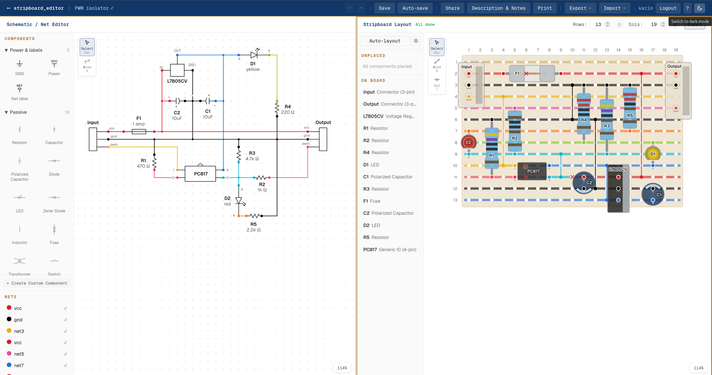

# Protoboard Editor

A layout editor for prototyping boards, with a built-in schematic editor. Draw a schematic, place the parts on a virtual board, and the copper takes the colour of your nets with live conflict detection and a list of what still needs to be connected. When the layout is done, print a true-scale template and build it.

<picture>
  <source media="(prefers-color-scheme: dark)" srcset="src/frontend/public/demo-circuit-dark.png">
  
</picture>

## Use it online

**https://sadmanbishal.com/Protoboard-Editor/** runs the editor in your browser, with no account and no install. This is the browser-only version:

- Your projects stay in that browser on that device (IndexedDB). Clearing the browser data deletes them. Use **Export** to keep a backup file, and **Import** to open it again, also on another device.
- It has no accounts, no share links and no parts library. Custom parts are kept inside each project.
- It cannot open project files from much older versions of the editor. Open such a file once in a self-hosted copy and export it again.

For accounts, share links and a parts library, run your own copy (see below).

## Board types

| Type | Copper | Auto-layout |
|---|---|---|
| Stripboard | copper strips along the rows, separated with cuts | yes |
| Dot board (single or double sided) | a pad per hole, joined with solder runs you lay | yes: it lays out strips and turns each one into runs, only from its first to its last used hole |
| Tripad board | pads joined in threes along each row, plus your runs | no |
| Breadboard PCB | power rails at the top and the bottom, blocks of five pads down each column, plus your runs | no |

- **Run tool (S):** click between two pads, across or down, to join them; drag from pad to pad to lay a run along the way. Click a run again to remove it. The copper a board comes with stays as it is.
- **Board sizes:** presets for the common green double-sided boards (2 x 8 cm to 15 x 20 cm) and breadboard PCBs, or any custom size. Only the 7 x 9 cm hole count (26 x 31) is counted on a real board; count yours and correct the rows and columns if they differ.
- **Print:** on pad boards the copper-side sheet is a run sheet: every run to solder, mirrored for the underside.

## Parts

The library has the common passives, semiconductors, connectors and ICs, plus Raspberry Pi Pico, ESP32 and Arduino Nano boards, an LM2596 buck module, a BLX-A 5 x 20 mm fuse holder and a DPST rocker switch.

## Self-hosting

The self-hosted version has everything: accounts, edit and view-only share links, a personal parts library, and projects stored on your server. It is a Next.js frontend and a Django backend with SQLite.

| | Browser-only (online) | Self-hosted |
|---|---|---|
| Editor, auto-layout, print, KiCad netlist export | yes | yes |
| Projects are kept | in the browser | on the server |
| Accounts, share links, parts library | no | yes |

Three ways to run it:

- **Windows:** for one PC, or for development.
- **Docker:** for a server on your network.
- **Proxmox:** Docker in an LXC container.

Keep a self-hosted copy on your own network. To put it on the internet, add HTTPS in front of it and set `SESSION_COOKIE_SECURE=true`.

### Windows

Needs [Node.js](https://nodejs.org) 20.9 or newer and [Python](https://www.python.org) 3.12 or newer.

One time:

```bat
cd src\frontend
npm ci
copy .env.example .env.local

cd ..\backend
python -m venv venv
venv\Scripts\python -m pip install -r requirements.txt
copy .env.example .env
venv\Scripts\python manage.py migrate
venv\Scripts\python manage.py createcachetable
```

Set your own random `DJANGO_SECRET_KEY` and `BACKUP_TOKEN` in `src\backend\.env`.

Then double-click `start-editor.bat`. It starts the backend (port 8000) and the editor (port 3000) in their own windows and opens http://localhost:3000. Close the two windows to stop them.

To log in, make a user once:

```bat
cd src\backend
venv\Scripts\python manage.py create_dev_admin --username admin --password <your password>
```

### Docker

Needs a Linux host with [Docker Engine](https://docs.docker.com/engine/install/) and the Compose plugin, and about 4 GB of RAM for the first build. Three containers start: the frontend, the backend and nginx, which serves both on one port.

1. Get the code:

   ```sh
   git clone https://github.com/the-clrsky/Protoboard-Editor.git /opt/protoboard-editor
   cd /opt/protoboard-editor
   ```

2. Decide the address that people will open, for example `http://192.168.1.50:8080` (the host's IP address or name, and a free port). Write it in a file `.env` next to `docker-compose.yml`:

   ```sh
   printf 'PUBLIC_URL=http://192.168.1.50:8080\nEDITOR_PORT=8080\n' > .env
   ```

   The address is built into the frontend. If you change it later, build again (step 5).

3. Make the backend settings. Make two random values with `openssl rand -base64 48`, and use them for `DJANGO_SECRET_KEY` and `BACKUP_TOKEN`:

   ```sh
   sudo mkdir -p /etc/protoboard-editor/data
   sudo nano /etc/protoboard-editor/.env
   ```

   ```ini
   DJANGO_SECRET_KEY=<random value>
   DJANGO_DEBUG=false
   # host names and IP addresses in PUBLIC_URL, comma-separated
   DJANGO_ALLOWED_HOSTS=192.168.1.50
   # exactly PUBLIC_URL
   CORS_ALLOWED_ORIGINS=http://192.168.1.50:8080
   SQLITE_DB_PATH=/etc/protoboard-editor/data/db.sqlite3
   # true only behind HTTPS
   SESSION_COOKIE_SECURE=false
   BACKUP_TOKEN=<another random value>
   # optional, for password-reset emails through Resend
   RESEND_API_KEY=
   ```

4. Start it:

   ```sh
   docker compose up -d --build
   ```

   The first build takes some minutes. Then open `PUBLIC_URL` and register an account.

5. Update to a new version:

   ```sh
   git pull
   docker compose up -d --build
   ```

   The backend brings stored projects up to the current file format when it starts.

**Backup:** all data is in `/etc/protoboard-editor/data/db.sqlite3`. Stop the backend with `docker compose stop django`, copy the file, then run `docker compose start django`.

### Proxmox

Run the Docker setup in an LXC container:

1. In Proxmox, create a container from a Debian 12 or 13 template. Use 2 cores, 4 GB of memory and a 16 GB disk, and give it a fixed IP address.
2. Docker in an unprivileged container needs two features. In the container's **Options > Features**, turn on **nesting** and **keyctl**. Or run this on the Proxmox host:

   ```sh
   pct set <container id> --features nesting=1,keyctl=1
   ```

3. Start the container, and open its console.
4. Install `git`, then Docker Engine as described for [Debian](https://docs.docker.com/engine/install/debian/).
5. Do the steps in [Docker](#docker), with the container's IP address in `PUBLIC_URL`.
6. Turn on **Start at boot** in the container's options. The containers restart on their own (`restart: unless-stopped`).

## Tests

```bat
cd src\frontend
npm run test:board
npm run test:solver
```

## Tech stack

- **Frontend:** Next.js
- **Backend:** Python Django, SQLite

One codebase gives two builds. With `NEXT_PUBLIC_API_URL` set, `next build` makes the full, self-hosted frontend. Without it, it makes the browser-only static export in `src/frontend/out` (set `NEXT_PUBLIC_BASE_PATH` and `NEXT_PUBLIC_SITE_URL` for a sub-path). GitHub Actions builds and publishes the browser-only version from `main` (`.github/workflows/pages.yml`).

## Feedback

Open an [issue](https://github.com/the-clrsky/Protoboard-Editor/issues).

## Credits and licence

Protoboard Editor is a fork of [Stripboard Editor](https://github.com/KarloFunke/stripboard-editor) by Karl Funke and is licensed under the [GNU General Public License v3.0](LICENSE), like the original. The fork adds the pad-board types, the board presets and the extra parts.

The built-in IC pinouts (pin numbers, pin names and descriptions) come from the [KiCad symbol library](https://gitlab.com/kicad/libraries/kicad-symbols) by the KiCad Library Team, licensed under [CC-BY-SA 4.0](https://creativecommons.org/licenses/by-sa/4.0/). They were selected, renamed and shortened for this editor by `src/frontend/scripts/importKicadIcs.js`. The resulting `src/frontend/data/icLibrary.ts` is licensed under CC-BY-SA 4.0 as well.
